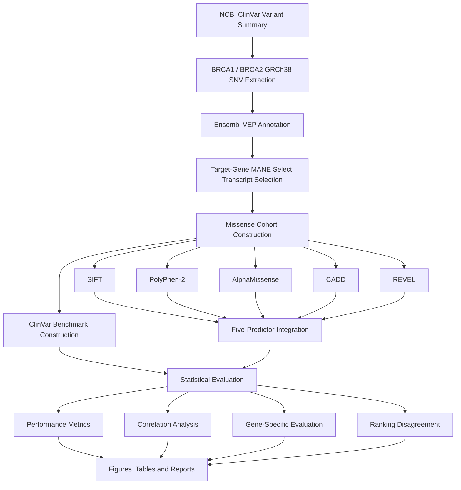

# Integrative Functional Impact Assessment of BRCA1 and BRCA2 Missense Variants

**A transcript-aware computational genomics pipeline integrating NCBI ClinVar, Ensembl Variant Effect Predictor, and five computational missense-effect prediction algorithms.**

---

## Abstract

The interpretation of missense variants in cancer-associated genes remains challenging because computational prediction algorithms differ in their underlying methodologies, training data, scoring systems, and predictive performance.

This project develops a reproducible computational pipeline to investigate the functional impact of missense variants in **BRCA1** and **BRCA2**. It integrates variant information from NCBI ClinVar, transcript-level functional annotation from Ensembl Variant Effect Predictor (VEP), and five computational predictors: SIFT, PolyPhen-2, AlphaMissense, CADD, and REVEL.

A GRCh38-based cohort of 28,302 candidate single-nucleotide variants was constructed. Following transcript-aware annotation and missense classification, 16,193 variants were retained in the primary missense cohort. ClinVar classifications were used to construct a primary binary benchmark containing 1,546 variants and a separate high-confidence benchmark containing 656 variants.

Predictor performance was assessed using ROC-AUC, average precision, stratified bootstrap confidence intervals, gene-specific evaluation, Spearman correlation, and predictor ranking disagreement.

AlphaMissense and CADD demonstrated the strongest overall discrimination in the primary benchmark. The findings also illustrate differences in predictor agreement and the importance of transcript selection, benchmark quality, class imbalance, and evidence limitations when interpreting computational predictions.

---

## 1. Research Background

BRCA1 and BRCA2 are tumour suppressor genes associated with hereditary breast, ovarian, and other cancer susceptibilities. Missense substitutions can alter protein structure or function, but determining their functional consequences is not straightforward.

Computational prediction tools provide complementary approaches to estimating the potential impact of amino-acid substitutions. However, their predictions are not necessarily interchangeable or independently validated.

This project investigates how multiple prediction algorithms characterize BRCA1 and BRCA2 missense variants and examines:

- Their ability to distinguish ClinVar pathogenic-side and benign-side classifications.
- Differences in predictive performance between algorithms.
- Agreement and disagreement between prediction scores.
- Differences in observed performance between BRCA1 and BRCA2.
- The importance of transcript-aware annotation and benchmark confidence.

### Research question

How effectively can an integrated computational framework combining NCBI variant evidence and multiple functional prediction algorithms characterize and prioritize BRCA1 and BRCA2 missense variants?

---

## 2. Research Objectives

1. Retrieve and process BRCA1 and BRCA2 variant records from NCBI ClinVar.
2. Construct a GRCh38 candidate SNV cohort using genomic reference and alternate alleles.
3. Annotate variants using Ensembl VEP and retain transcript-level consequences.
4. Select appropriate target-gene MANE Select transcripts.
5. Identify missense variants and construct a transcript-aware analysis cohort.
6. Integrate ClinVar classifications and review-status information.
7. Construct primary and high-confidence binary benchmark datasets.
8. Integrate five computational predictors:
   - SIFT
   - PolyPhen-2
   - AlphaMissense
   - CADD PHRED
   - REVEL
9. Evaluate predictive performance and score correlations.
10. Investigate gene-specific performance and disagreement between predictors.
11. Produce reproducible figures, tables, reports, and provenance records.

---

## 3. Data Sources

| Resource | Purpose |
|---|---|
| NCBI ClinVar | Variant records, genomic alleles, clinical significance, review status |
| Ensembl VEP | Variant consequences, transcript annotation, MANE and predictor annotations |
| AlphaMissense | Protein missense pathogenicity predictions |
| SIFT | Evolutionary conservation-based functional prediction |
| PolyPhen-2 | Protein sequence and structural feature-based prediction |
| CADD | Combined annotation-dependent deleteriousness scores |
| REVEL | Ensemble-based missense variant prediction |

### Genome assembly

GRCh38 was used as the reference assembly for the genomic variant cohort and AlphaMissense matching.

### Variant identity

Variants were identified using:

`chromosome:position:reference_allele:alternate_allele`

The VCF reference and alternate allele fields were used rather than ClinVar allele columns that did not contain usable nucleotide values for the extracted records.

---

## 4. Cohort Construction

### 4.1 ClinVar extraction

The ClinVar variant summary dataset was filtered to retain BRCA1 and BRCA2 records and the GRCh38 assembly.

The extraction process identified:

| Processing stage | Variants |
|---|---:|
| BRCA1/BRCA2 ClinVar records | 75,740 |
| GRCh38 records | 37,476 |
| Candidate SNV records | 28,311 |
| Canonical A/C/G/T SNVs retained | 28,302 |
| Ambiguous or invalid allele records excluded | 9 |

No duplicate genomic variant keys were identified in the final candidate cohort.

### 4.2 VEP annotation

All 28,302 candidate variants were submitted to Ensembl VEP using batched requests.

Annotation included:

- Transcript consequences.
- MANE annotations.
- Canonical transcript information.
- HGVS genomic and protein notation.
- Protein identifiers.
- Consequence terms.
- Transcript support information.

**Annotation coverage:**

- Variants returned: 28,302 / 28,302.
- Transcript consequence records: 867,142.
- Failed variants: 0.

### 4.3 Primary transcript selection

Transcript selection followed a target-gene-aware strategy:

1. Restrict transcript candidates to the ClinVar target gene.
2. Prefer the MANE Select transcript.
3. Use a canonical target-gene transcript only when an appropriate MANE Select transcript is unavailable.
4. Retain unresolved cases for manual review rather than substituting an unrelated gene transcript.

Results:

| Selection outcome | Variants |
|---|---:|
| Target-gene MANE Select | 28,301 |
| Manual review required | 1 |
| Total retained | 28,302 |

The single manual-review variant did not have an appropriate BRCA2 transcript consequence in the returned annotation.

### 4.4 Missense cohort

Following transcript-aware consequence classification:

| Gene | Missense variants | Non-missense variants |
|---|---:|---:|
| BRCA1 | 6,374 | 5,340 |
| BRCA2 | 9,819 | 6,768 |
| **Total** | **16,193** | **12,108** |

One additional variant was retained separately for manual transcript review.

The resulting primary missense cohort contains **16,193 variants**.

---

## 5. ClinVar Benchmark Construction

ClinVar classifications were grouped into pathogenic-side and benign-side categories.

### Pathogenic-side labels

- Pathogenic
- Likely pathogenic
- Pathogenic/Likely pathogenic

### Benign-side labels

- Benign
- Likely benign
- Benign/Likely benign

Variants with uncertain, conflicting, missing, or otherwise unsuitable classifications were not converted into binary labels.

### Benchmark statistics

| Benchmark | Total | Pathogenic-side | Benign-side |
|---|---:|---:|---:|
| Primary benchmark | 1,546 | 342 | 1,204 |
| High-confidence benchmark | 656 | 252 | 404 |

Of the 16,193 missense variants:

- 1,546 were eligible for primary binary evaluation.
- 14,647 were excluded from primary binary evaluation because their classifications were unsuitable for an unambiguous binary comparison.

The high-confidence benchmark is a separate sensitivity analysis using stricter evidence eligibility criteria.

ClinVar classifications are evidence-based clinical assertions, not an independent experimental gold standard.

---

## 6. Computational Predictors

Five predictors were integrated into the missense cohort.

| Predictor | Score | Interpretation |
|---|---|---|
| SIFT | SIFT score | Lower values indicate greater predicted deleteriousness |
| PolyPhen-2 | PolyPhen score | Higher values indicate greater predicted damage |
| AlphaMissense | Pathogenicity score | Higher values indicate greater predicted pathogenicity |
| CADD | PHRED score | Higher values indicate greater predicted deleteriousness |
| REVEL | REVEL score | Higher values indicate greater predicted pathogenicity |

### Predictor coverage

All five predictors had complete coverage across the 16,193-variant missense cohort.

| Predictor | Available scores |
|---|---:|
| SIFT | 16,193 |
| PolyPhen-2 | 16,193 |
| AlphaMissense | 16,193 |
| CADD PHRED | 16,193 |
| REVEL | 16,193 |

For comparative analyses, SIFT was direction-aligned using `1 - SIFT score`, so that higher transformed values consistently represented greater predicted damage.

CADD raw scores were retained for provenance and supplementary analysis; CADD PHRED was used for the primary predictor comparison.

AlphaMissense genomic matches were established using exact GRCh38 genomic variant keys. Protein substitution consistency was also checked against VEP annotations.

---

## 7. Statistical Evaluation

The five predictors were evaluated against both benchmark datasets.

### Performance metrics

**ROC-AUC**

Measures the ability of a predictor to rank pathogenic-side variants above benign-side variants across classification thresholds.

**Average precision (AP)**

Summarises precision-recall performance and is particularly relevant when the benchmark contains unequal class proportions.

### Confidence intervals

- 2,000 stratified bootstrap resamples.
- Random seed: 42.
- 95% percentile confidence intervals.

### Additional analyses

- BRCA1 and BRCA2 subgroup performance.
- Spearman rank correlation between predictor scores.
- Predictor percentile-rank disagreement across the complete missense cohort.
- Primary versus high-confidence benchmark comparison.

Average precision depends on pathogenic prevalence. Therefore, it should not be interpreted independently of benchmark composition.

---

## 8. Results

### 8.1 Primary benchmark performance

The primary benchmark contains 1,546 variants, including 342 pathogenic-side and 1,204 benign-side variants.

| Predictor | ROC-AUC | 95% CI | Average precision |
|---|---:|---|---:|
| AlphaMissense | **0.953** | 0.937–0.967 | **0.910** |
| CADD PHRED | 0.951 | 0.938–0.961 | 0.838 |
| REVEL | 0.928 | 0.910–0.946 | 0.847 |
| SIFT | 0.859 | 0.843–0.874 | 0.513 |
| PolyPhen-2 | 0.750 | 0.720–0.779 | 0.490 |

AlphaMissense achieved the highest observed ROC-AUC and average precision. CADD PHRED showed a similarly strong ROC-AUC.

The confidence intervals for AlphaMissense and CADD overlap. These results do not establish statistically significant superiority of one predictor over the other.

### 8.2 High-confidence benchmark performance

The high-confidence benchmark contains 656 variants, including 252 pathogenic-side and 404 benign-side variants.

| Predictor | ROC-AUC | Average precision |
|---|---:|---:|
| AlphaMissense | **0.957** | **0.953** |
| CADD PHRED | 0.948 | 0.889 |
| REVEL | 0.927 | 0.907 |
| SIFT | 0.874 | 0.723 |
| PolyPhen-2 | 0.761 | 0.668 |

The relative performance pattern was broadly consistent with the primary benchmark.

### 8.3 Predictor correlations

Spearman correlation analysis was performed across the full missense cohort of 16,193 variants.

Selected correlations:

| Predictor pair | Spearman correlation |
|---|---:|
| SIFT–CADD PHRED | 0.793 |
| AlphaMissense–CADD PHRED | 0.666 |
| PolyPhen-2–CADD PHRED | 0.664 |
| SIFT–AlphaMissense | 0.635 |
| SIFT–PolyPhen-2 | 0.575 |
| CADD PHRED–REVEL | 0.517 |
| AlphaMissense–REVEL | 0.457 |
| SIFT–REVEL | 0.395 |
| PolyPhen-2–REVEL | 0.341 |

The correlations demonstrate that predictors share some ranking information but are not interchangeable.

Correlation does not establish correctness or independent biological validation.

### 8.4 Gene-specific evaluation

Primary benchmark ROC-AUC and average precision:

| Gene | Predictor | ROC-AUC | AP |
|---|---|---:|---:|
| BRCA1 | SIFT | 0.867 | 0.657 |
| BRCA1 | PolyPhen-2 | 0.663 | 0.419 |
| BRCA1 | AlphaMissense | 0.952 | 0.938 |
| BRCA1 | CADD PHRED | 0.949 | 0.896 |
| BRCA1 | REVEL | 0.927 | 0.879 |
| BRCA2 | SIFT | 0.858 | 0.367 |
| BRCA2 | PolyPhen-2 | 0.915 | 0.698 |
| BRCA2 | AlphaMissense | 0.951 | 0.850 |
| BRCA2 | CADD PHRED | 0.963 | 0.799 |
| BRCA2 | REVEL | 0.918 | 0.800 |

Gene-specific benchmark sizes and pathogenic prevalence differ. These subgroup results are descriptive and should not be interpreted as proof of intrinsic gene-specific predictor superiority.

### 8.5 Predictor ranking disagreement

Predictor disagreement was assessed through differences in percentile rankings across the complete missense cohort.

This analysis identifies variants for which the five algorithms assign substantially different relative rankings. It is intended to highlight candidates for further investigation, not to determine which predictor is correct.

---

## 9. Visualisations and Results

Generated figures are available under `results/figures/`.

| Figure | Description |
|---|---|
| `roc_curves_primary.png` | ROC curves for the primary benchmark |
| `pr_curves_primary.png` | Precision-recall curves for the primary benchmark |
| `roc_curves_high_confidence.png` | ROC curves for the high-confidence benchmark |
| `pr_curves_high_confidence.png` | Precision-recall curves for the high-confidence benchmark |
| `predictor_correlation_heatmap.png` | Correlation between five predictor scores |
| `predictor_score_distributions.png` | Predictor score distributions |
| `predictor_rank_disagreement.png` | Relative predictor ranking disagreement |

Evaluation tables are available under `results/tables/`.

The consolidated evaluation report is:

`results/reports/predictor_evaluation_report.md`

---

## 10. Pipeline Architecture



---

## 11. Repository Structure

```text
ncbi-functional-variant-analysis/
│
├── config/
│
├── data/
│   ├── raw/
│   ├── processed/
│   └── metadata/
│
├── docs/
│   ├── references.md
│   └── study_summary.md
│
├── notebooks/
│
├── results/
│   ├── figures/
│   ├── tables/
│   └── reports/
│
├── src/
│   ├── clinvar_downloader.py
│   ├── vep_full_annotation.py
│   ├── select_primary_transcripts.py
│   ├── classify_primary_missense.py
│   ├── build_clinvar_benchmark.py
│   ├── alphamissense_downloader.py
│   ├── extract_alphamissense_cohort.py
│   ├── integrate_alphamissense.py
│   ├── vep_full_predictor_annotation.py
│   ├── integrate_all_predictors.py
│   └── run_predictor_evaluation.py
│
├── tests/
├── workflows/
├── requirements.txt
├── .gitignore
└── README.md
```

The source directory also contains pilot, audit, and diagnostic scripts supporting individual pipeline stages.

Large raw and processed datasets are intentionally excluded from version control.

---

## 12. Reproducibility

### Environment

- Python 3.10
- pandas
- NumPy
- SciPy
- scikit-learn
- Matplotlib
- Requests
- tqdm

Install the project in a virtual environment.

**Windows PowerShell**

```powershell
py -3.10 -m venv .venv
.\.venv\Scripts\Activate.ps1
python -m pip install --upgrade pip
pip install -r requirements.txt
```

### Execution order

Run commands from the repository root.

1. Download and extract ClinVar records.
2. Run VEP pilot and full-cohort annotation.
3. Select target-gene primary transcripts.
4. Classify missense and non-missense variants.
5. Construct ClinVar primary and high-confidence benchmarks.
6. Download and extract AlphaMissense cohort predictions.
7. Integrate AlphaMissense with the cohort.
8. Run VEP CADD and REVEL annotation.
9. Integrate all five predictor scores.
10. Execute statistical evaluation and generate reports.

Important final-stage commands:

```powershell
python .\src\select_primary_transcripts.py
python .\src\classify_primary_missense.py
python .\src\build_clinvar_benchmark.py
python .\src\integrate_alphamissense.py
python .\src\integrate_all_predictors.py
python .\src\run_predictor_evaluation.py
```

Full-cohort VEP annotation and data acquisition are network-intensive. Review existing run manifests and checkpoints before restarting these stages. Do not rerun completed full-cohort jobs unnecessarily.

The exact acquisition parameters, retrieval timestamps, checksums, and processing summaries are recorded in `data/metadata/`.

---

## 13. Data Provenance and Licensing

The repository records source URLs, retrieval timestamps, checksums, processing reports, and annotation metadata.

Raw and processed datasets are not committed because of their size and source-specific distribution conditions.

### AlphaMissense licensing consideration

The downloaded AlphaMissense file contains an embedded header declaring **CC BY-NC-SA 4.0**. Its checksum matches the file published in Zenodo record `10813168` (v3), whose record metadata declares **CC BY 4.0**.

This discrepancy is recorded in:

`data/metadata/alphamissense_download_manifest.json`

The applicable licence must be confirmed with the rights holder or the organisation's legal/licensing team before commercial use. The discrepancy is not treated as resolved.

---

## 14. Limitations

1. ClinVar classifications are not an independent experimental gold standard.
2. A substantial proportion of the missense cohort has uncertain or conflicting classifications and cannot be included in the primary binary benchmark.
3. ClinVar review status and evidence strength vary across records.
4. Predictor training datasets may overlap with ClinVar or related clinical evidence, creating potential evidence dependence or data leakage.
5. Average precision depends on class prevalence and benchmark composition.
6. Gene-specific benchmark sizes and class distributions differ.
7. Predictor correlation and ranking agreement do not establish biological correctness.
8. Independent functional experiments and external validation cohorts are required to establish broader generalisability.

---

## 15. Conclusion

This project establishes a transcript-aware and reproducible computational framework for comparative assessment of BRCA1 and BRCA2 missense variant predictions.

The analysis demonstrates that:

- A substantial BRCA1/BRCA2 missense cohort can be constructed through systematic ClinVar extraction and VEP annotation.
- Target-gene transcript selection is an important safeguard against incorrect consequence assignment.
- AlphaMissense and CADD achieved the strongest observed overall performance against the constructed ClinVar benchmarks.
- The five predictors show meaningful differences in their rankings and levels of agreement.
- Benchmark composition, classification confidence, gene-specific prevalence, and potential evidence dependence must be considered when interpreting prediction performance.

The framework provides a foundation for further investigation, experimental validation, and research-oriented prioritisation of candidate variants.

**This work supports computational research and does not establish clinical pathogenicity or replace clinical variant interpretation.**

---

## 16. References

1. Landrum, M. J., et al. (2020). ClinVar: improving access to variant interpretations and supporting evidence. *Nucleic Acids Research*. https://doi.org/10.1093/nar/gkz972
2. McLaren, W., et al. (2016). The Ensembl Variant Effect Predictor. *Genome Biology*. https://doi.org/10.1186/s13059-016-0974-4
3. Ng, P. C., and Henikoff, S. (2003). SIFT: predicting amino acid changes that affect protein function. *Nucleic Acids Research*. https://doi.org/10.1093/nar/gkg509
4. Adzhubei, I. A., et al. (2010). A method and server for predicting damaging missense mutations. *Nature Methods*. https://doi.org/10.1038/nmeth0410-248
5. Ioannidis, N. M., et al. (2016). REVEL: an ensemble method for predicting the pathogenicity of rare missense variants. *The American Journal of Human Genetics*. https://doi.org/10.1016/j.ajhg.2016.08.016
6. Rentzsch, P., et al. (2019). CADD: predicting the deleteriousness of variants throughout the human genome. *Nucleic Acids Research*. https://doi.org/10.1093/nar/gky1016
7. Cheng, J., et al. (2023). Accurate proteome-wide missense variant effect prediction with AlphaMissense. *Science*. https://doi.org/10.1126/science.adg7492

---

**Project focus:** Computational Genomics | Variant Annotation | Bioinformatics | Functional Prediction | Statistical Evaluation | Reproducible Research
